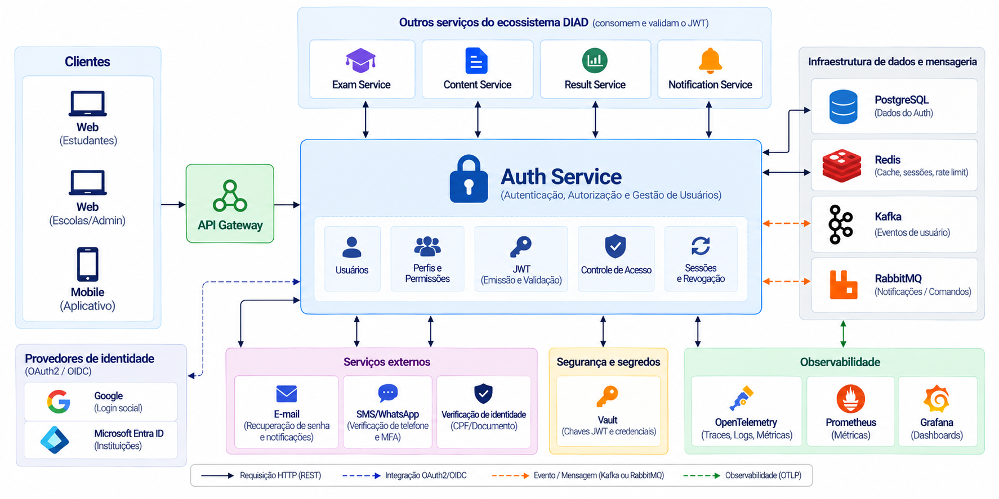
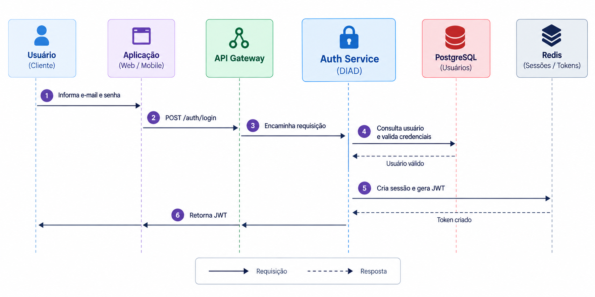
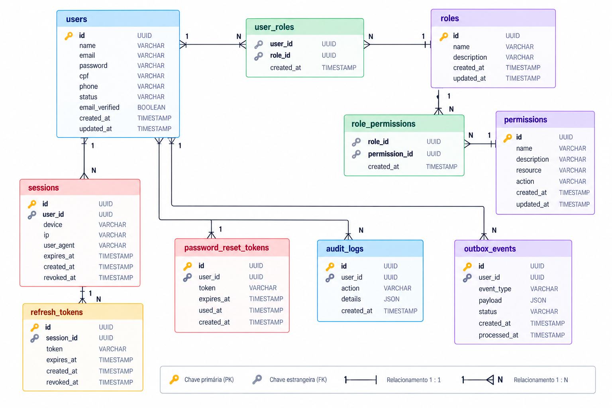
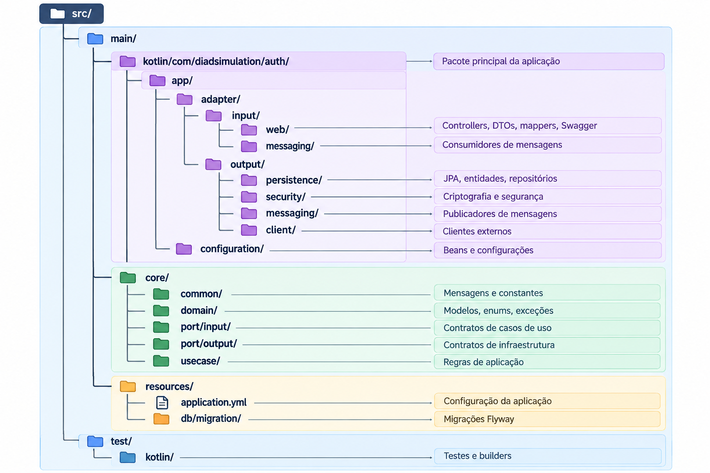

# DIAD Auth Service

**Serviço de identidade, autenticação e autorização do ecossistema DIAD Simulation.**

## Sumário

1. [Visão geral](#visão-geral)
2. [Funcionalidades](#funcionalidades)
3. [Tecnologias](#tecnologias)
4. [Arquitetura da solução](#arquitetura-da-solução)
5. [Integração entre serviços](#integração-entre-serviços)
6. [Modelagem de dados](#modelagem-de-dados)
7. [Autenticação e autorização](#autenticação-e-autorização)
8. [API REST e Swagger](#api-rest-e-swagger)
9. [Estrutura do projeto](#estrutura-do-projeto)
10. [Pré-requisitos](#pré-requisitos)
11. [Execução local](#execução-local)
12. [Docker](#docker)
13. [Configurações](#configurações)
14. [Build, testes e qualidade](#build-testes-e-qualidade)
15. [Observabilidade e segurança](#observabilidade-e-segurança)
16. [Status da implementação](#status-da-implementação)

## Visão geral

**Documentação/repositório principal** → https://github.com/diogobackend/diad-simulation-platform

O **DIAD Simulation** é uma plataforma de simulação de provas, vestibulares, ENEM, concursos e certificações. O **DIAD Auth Service** concentra a identidade dos usuários, o cadastro, a autenticação e o controle de acesso às operações de gerenciamento de usuários.

O serviço já disponibiliza uma API REST para cadastro, login, consulta, listagem, atualização, exclusão e administração de perfil de acesso. As operações protegidas utilizam autenticação JWT e autorização baseada em papéis e no usuário-alvo.

## Funcionalidades

### Implementadas

- Cadastro público de usuários com atribuição automática e obrigatória da role `CANDIDATE`.
- Login por **e-mail ou login (username)** e senha, com emissão de token JWT.
- Armazenamento seguro de senha com **BCrypt**.
- Perfis `CANDIDATE`, `SCHOOL_ADMIN` e `PLATFORM_ADMIN`.
- Controle de acesso por **RBAC**, complementado por autorização sobre o usuário consultado ou modificado.
- Consulta de usuário por ID, e-mail, login, CPF ou RG, com validação dos parâmetros de busca.
- Listagem paginada, com ordenação ascendente/descendente e filtros por dados cadastrais, role, status e datas.
- Pesquisa textual parcial sem diferenciação entre maiúsculas e minúsculas.
- Atualização parcial de dados de perfil.
- CPF, RG e data de nascimento preenchíveis apenas quando ainda não definidos; data de nascimento futura não é permitida.
- Exclusão de usuários conforme as permissões do perfil autenticado.
- Alteração de `role` e `status` exclusivamente por `PLATFORM_ADMIN`.
- Validação de dados e prevenção de duplicidades conforme as regras implementadas.
- Tratamento de respostas HTTP e documentação OpenAPI/Swagger.
- Testes automatizados com JUnit 5 e MockK e verificação de cobertura com JaCoCo.

### Planejadas para a evolução do serviço

- Refresh tokens, rotação e revogação de sessões.
- Logout com invalidação de sessão/token, conforme estratégia a definir.
- Recuperação e redefinição de senha.
- Auditoria persistente de autenticações e alterações sensíveis.
- Publicação de eventos de identidade via Kafka e processamento assíncrono via RabbitMQ.
- Integração de verificação de tokens entre serviços, incluindo eventual uso de JWKS.
- Instrumentação de observabilidade distribuída.

## Tecnologias

| Camada | Tecnologias |
|---|---|
| Linguagem | Kotlin 2.4.20, Java 25 |
| Framework | Spring Boot 4.0.8, Spring Web |
| Segurança | Spring Security, BCrypt, JWT, RBAC |
| Persistência | PostgreSQL 17, Spring Data JPA, Hibernate, Flyway |
| Mensageria planejada | Apache Kafka, RabbitMQ |
| API | REST, JSON, OpenAPI / Swagger UI |
| Observabilidade planejada | Spring Boot Actuator, OpenTelemetry |
| Infraestrutura local | Docker, Docker Compose |
| Testes | JUnit 5, MockK, JaCoCo |
| Padronização | ktlint |

> As versões acima foram preservadas da documentação fornecida. Consulte `build.gradle.kts` para confirmar as versões efetivamente configuradas na revisão atual do repositório.

## Arquitetura da solução



O serviço utiliza **arquitetura hexagonal (Ports & Adapters)**, separando regras de domínio, casos de uso e integrações externas.

**Divisão de responsabilidades:**

- **Core/domain:** modelo de usuário, value objects, enums, critérios de busca e regras de domínio.
- **Core/usecase:** casos de uso de cadastro, autenticação, consulta, listagem, atualização, exclusão e alteração de acesso.
- **Ports:** contratos de entrada e saída que desacoplam os casos de uso da infraestrutura.
- **Adapters/input:** controladores REST, requests/responses, mapeadores e documentação da API.
- **Adapters/output:** adaptadores de persistência JPA e demais integrações implementadas.
- **Configuration/security:** configuração de autenticação JWT, regras HTTP e autorização por usuário-alvo.

A classe `UserAccessAuthorization` centraliza regras de acesso ao usuário solicitado e a definição do escopo permitido para a listagem. O `UserPersistenceAdapter` aplica esse escopo na consulta ao banco.

## Integração entre serviços

| Canal | Situação | Finalidade |
|---|---|---|
| HTTP/REST | Implementado | Cadastro, login e gerenciamento de usuários |
| JWT | Implementado no fluxo de autenticação | Identificação e autorização de requisições protegidas |
| PostgreSQL | Implementado | Persistência de usuários |
| Kafka | Planejado | Eventos de identidade para outros microsserviços |
| RabbitMQ | Planejado | Comandos e notificações assíncronas |
| JWKS | Planejado/a confirmar | Distribuição de chaves para validação de tokens por outros serviços |

### Fluxo de autenticação



**Fluxo atual:**

1. O cliente envia e-mail **ou** login e senha para `POST /login`.
2. O serviço valida as credenciais e as condições de acesso do usuário.
3. Em caso de sucesso, retorna um token JWT.
4. O cliente utiliza o token nas operações protegidas.
5. O Spring Security verifica a autenticação e as roles; nas operações sobre usuários, `UserAccessAuthorization` também verifica a permissão sobre o alvo.

> O diagrama acima foi mantido como no README original. Elementos de refresh token, sessão ou revogação eventualmente representados nele fazem parte da evolução planejada, não do fluxo confirmado nesta etapa.

## Modelagem de dados

**Modelo lógico de referência da solução completa.** A implementação atual utiliza persistência de usuários e suas informações cadastrais e de acesso. As entidades de sessões, refresh tokens, auditoria e outbox representadas no modelo de referência não devem ser interpretadas como já implementadas.



### Modelo de usuário utilizado na API

| Campo | Descrição |
|---|---|
| `userId` | Identificador UUID |
| `name` | Nome do usuário |
| `email` | E-mail de autenticação e contato |
| `login` | Login alternativo ao e-mail |
| `passwordHash` | Hash da senha, não exposto nas respostas públicas |
| `role` | `CANDIDATE`, `SCHOOL_ADMIN` ou `PLATFORM_ADMIN` |
| `status` | Estado de acesso do usuário |
| `phone` | Telefone |
| `cpf` | CPF, quando informado |
| `rg` | RG, quando informado |
| `address` | Endereço |
| `birthDate` | Data de nascimento |
| `createdAt` / `updatedAt` | Datas de criação e atualização |

**Regras relevantes:**

- O cadastro público sempre define `role = CANDIDATE`; o cliente não escolhe a role no `RegisterUserRequest`.
- A alteração de `role` ou `status` é uma operação administrativa separada.
- CPF, RG e data de nascimento não podem ser substituídos após preenchidos, conforme a regra de atualização implementada.
- A data de nascimento não pode ser futura.

### Cardinalidades da modelagem-alvo

- **Usuário ↔ perfil:** N:N por `USER_ROLES` no modelo de referência; **na implementação atual, cada usuário possui uma única role**.
- **Perfil ↔ permissão:** N:N por `ROLE_PERMISSIONS` no modelo de referência; **na implementação atual, as permissões são definidas pelas roles e regras de autorização no código**.
- **Usuário → sessão:** 1:N, planejado.
- **Sessão → refresh token:** 1:N, planejado.
- **Usuário → recuperação de senha:** 1:N, planejado.
- **Usuário → auditoria:** 1:N, planejado.
- **Usuário → evento de outbox:** 1:N, planejado.

As tabelas e migrações futuras devem refletir a modelagem que vier a ser efetivamente adotada.

## Autenticação e autorização

A segurança combina **Spring Security**, autenticação por JWT, verificação de role no nível da rota e autorização sobre o usuário-alvo.

### Perfis de acesso

| Operação | `CANDIDATE` | `SCHOOL_ADMIN` | `PLATFORM_ADMIN` |
|---|---|---|---|
| `POST /users` (cadastro público) | Permitido | Permitido | Permitido |
| `POST /login` | Permitido | Permitido | Permitido |
| Listar usuários (`GET /users`) | Negado | Candidatos + próprio registro | Todos |
| Buscar usuário (`GET /users/id`) | Somente próprio registro | Candidatos + próprio registro | Qualquer usuário |
| Atualizar perfil (`PATCH /users/{userId}`) | Somente próprio registro | Candidatos + próprio registro | Qualquer usuário |
| Excluir usuário (`DELETE /users/{userId}`) | Negado | Candidatos + próprio registro | Qualquer usuário |
| Alterar role/status (`PATCH /users/{userId}/access`) | Negado | Negado | Permitido |

**Restrições importantes:**

- `SCHOOL_ADMIN` não pode consultar, alterar ou excluir outro `SCHOOL_ADMIN` nem um `PLATFORM_ADMIN`.
- `SCHOOL_ADMIN` pode consultar e atualizar o próprio perfil e, conforme a autorização implementada, também excluir o próprio registro.
- `CANDIDATE` não pode listar usuários nem acessar registros de terceiros.
- `PLATFORM_ADMIN` tem acesso administrativo a todos os usuários.
- O endpoint de alteração de acesso é reservado a `PLATFORM_ADMIN`, inclusive quando a alteração solicitada se refere ao próprio usuário.

### Escopo seguro da listagem

O cliente **não envia** os parâmetros internos `allowedRole` e `allowedUserId`. O backend os define a partir do usuário autenticado:

- `PLATFORM_ADMIN`: listagem sem restrição adicional de role/ID.
- `SCHOOL_ADMIN`: condição equivalente a `role = CANDIDATE OR userId = ID_DO_ADMIN_AUTENTICADO`.
- `CANDIDATE`: requisição de listagem rejeitada.

Os filtros informados na API são combinados com essa restrição, não a substituem. Assim, um `SCHOOL_ADMIN` que solicite filtrar por `PLATFORM_ADMIN` não recebe registros administrativos.

> A restrição da listagem depende de o fluxo de consulta preencher os campos internos de autorização. Novos consumidores do caso de uso/repositório devem preservar essa regra.

### Respostas de segurança

- **401 Unauthorized:** ausência de autenticação válida ou token inválido, conforme a configuração de segurança.
- **403 Forbidden:** autenticação válida, porém sem permissão para a rota ou para o usuário-alvo.

O comportamento das permissões foi exercitado no Swagger com usuários de diferentes roles. Tokens e senhas de teste não devem ser incluídos na documentação.

## API REST e Swagger

### Swagger local

- **Swagger UI:** http://localhost:8080/swagger-ui.html
- **OpenAPI JSON:** http://localhost:8080/v3/api-docs

### Endpoints implementados

| Método | Rota | Responsabilidade | Respostas documentadas |
|---|---|---|---|
| `POST` | `/users` | Cadastrar usuário como `CANDIDATE` | `201`, `400`, `409`, `500` |
| `POST` | `/login` | Autenticar por e-mail ou login e emitir JWT | `200`, `400`, `401`, `403`, `500` |
| `GET` | `/users` | Listar com paginação, ordenação, filtros e escopo por role | `200`, `400`, `401`, `403`, `500` |
| `GET` | `/users/id` | Buscar usuário por identificador ou dado cadastral | `200`, `400`, `401`, `403`, `404`, `500` |
| `PATCH` | `/users/{userId}` | Atualizar parcialmente o perfil | `200`, `400`, `401`, `403`, `404`, `409`, `500` |
| `DELETE` | `/users/{userId}` | Excluir usuário conforme permissão | `204`, `400`, `401`, `403`, `404`, `500` |
| `PATCH` | `/users/{userId}/access` | Atualizar role e/ou status (somente `PLATFORM_ADMIN`) | `200`, `400`, `401`, `403`, `404`, `500` |

> As respostas indicadas correspondem aos contratos OpenAPI discutidos. A ocorrência efetiva de cada erro depende da validação e dos handlers configurados.

### Regras das requisições

- `POST /users` é público, mas **não aceita seleção de role** pelo cliente.
- `POST /login` aceita e-mail **ou** login e senha.
- `GET /users` suporta paginação (`page`, `size`), ordenação (`sortBy`, `direction`) e filtros de texto, enums e datas.
- `GET /users/id` permite localizar por `userId`, e-mail, login, CPF ou RG, informando apenas um identificador por requisição.
- `PATCH /users/{userId}` atualiza campos de perfil sem conceder permissão para alterar role/status.
- `PATCH /users/{userId}/access` recebe as alterações administrativas de role e/ou status.

### Endpoints planejados, ainda não confirmados como implementados

- Renovação de token (`refresh`).
- Logout e revogação de sessão.
- Recuperação/redefinição de senha.
- Consulta dedicada de identidade autenticada (`/users/me`), se necessária.

## Estrutura do projeto



A estrutura segue o padrão de camadas e adaptadores descrito na seção de arquitetura. O diagrama foi preservado sem alterações no caminho da imagem.

## Pré-requisitos

- **JDK 25**, conforme a configuração documentada.
- **Docker** com Docker Compose.
- **Git**.

## Execução local

Comandos para **Windows PowerShell**:

```powershell
git clone https://github.com/diogobackend/dia-d-auth-service.git
cd dia-d-auth-service

# Inicializar PostgreSQL
docker compose up -d

# Executar aplicação
.\gradlew.bat bootRun
```

A aplicação utiliza a porta padrão `8080`, desde que não seja sobrescrita.

**Acessos:**

- Swagger: http://localhost:8080/swagger-ui.html
- OpenAPI: http://localhost:8080/v3/api-docs

No Linux/macOS, substitua `.\gradlew.bat` por `./gradlew`.

## Docker

O `compose.yml` descrito nesta documentação provisiona **apenas o PostgreSQL**, não a aplicação, Kafka ou RabbitMQ.

```powershell
# Subir PostgreSQL em segundo plano
docker compose up -d

# Verificar contêineres
docker compose ps

# Consultar logs
docker compose logs -f postgres

# Parar e remover contêineres
docker compose down

# Apagar também os dados persistidos (ação destrutiva)
docker compose down -v
```

**Banco local:**

| Propriedade | Valor |
|---|---|
| Imagem | `postgres:17` |
| Contêiner | `diad-auth-postgres` |
| Host | `localhost` |
| Porta | `5432` |
| Database | `diad_auth` |
| Usuário | `diad_auth` |
| Senha de desenvolvimento | `diad_auth` |

O volume nomeado `diad_auth_postgres_data` preserva os dados entre reinicializações. A credencial acima é apenas de desenvolvimento local e não deve ser reutilizada em outros ambientes.

## Configurações

Configurações documentadas em `src/main/resources/application.yml`:

- `spring.datasource.*`: conexão PostgreSQL.
- `spring.jpa.hibernate.ddl-auto: validate`: valida o esquema sem criá-lo automaticamente.
- `spring.flyway.enabled: true`: executa migrações versionadas.
- `springdoc.swagger-ui.path: /swagger-ui.html`.
- `springdoc.api-docs.path: /v3/api-docs`.
- Configuração de segurança JWT: conferir as propriedades e variáveis efetivamente declaradas no projeto.

**Configurações futuras:** Kafka, RabbitMQ, refresh tokens, auditoria e observabilidade devem ser parametrizados por ambiente. Chaves de assinatura e credenciais reais não devem ser versionadas.

## Build, testes e qualidade

Comandos principais no Windows:

```powershell
# Corrigir formatação
.\gradlew.bat ktlintFormat

# Validar padrão Kotlin
.\gradlew.bat ktlintCheck

# Executar testes
.\gradlew.bat test

# Verificações gerais
.\gradlew.bat check

# Build completo
.\gradlew.bat clean build

# Gerar relatório de cobertura
.\gradlew.bat jacocoTestReport

# Validar limite configurado de cobertura
.\gradlew.bat jacocoTestCoverageVerification
```

**Validação em uma única execução:**

```powershell
.\gradlew.bat ktlintFormat ktlintCheck test jacocoTestCoverageVerification check clean build
```

### Cobertura de testes

Os testes utilizam **JUnit 5** e **MockK**, incluindo cenários de sucesso, validação, autorização e falhas de persistência. A cobertura é inspecionada com **JaCoCo**.

Entre os componentes testados nesta etapa estão:

- `UserSearchCriteria`, incluindo os campos internos `allowedRole` e `allowedUserId`.
- `UserPersistenceAdapter`, incluindo a composição de filtros JPA e a restrição de listagem para `SCHOOL_ADMIN`.
- `UserAccessAuthorization`, incluindo permissões dos três perfis, acesso ao próprio registro, restrição a outros administradores e escopo de listagem.

O projeto possui regra de **100% de cobertura mínima** na verificação configurada. A conclusão dos testes e a validação funcional no Swagger foram relatadas durante o desenvolvimento; isso não substitui a conferência do relatório JaCoCo atualizado para todo o projeto e de eventuais exclusões configuradas.

**Observações:**

- O projeto usa **ktlint**; **Detekt não está habilitado** na configuração documentada.
- O hook `.git/hooks/pre-commit` é local e não é distribuído automaticamente pelo Git.
- `ktlintFormat` pode alterar arquivos: revise as mudanças antes do commit.

## Observabilidade e segurança

### Segurança implementada

- Autenticação por JWT e controle de acesso HTTP com Spring Security.
- Proteção de senhas com BCrypt.
- RBAC para `CANDIDATE`, `SCHOOL_ADMIN` e `PLATFORM_ADMIN`.
- Autorização por identidade do usuário-alvo.
- Escopo de listagem aplicado na consulta de persistência.
- Validações de entrada, restrições de alteração cadastral e respostas de erro documentadas.

### Evolução planejada

- Health checks e métricas com Spring Boot Actuator.
- Logs estruturados e rastreamento distribuído com OpenTelemetry.
- Auditoria de login, logout, falhas e mudanças de permissão.
- Monitoramento de mensageria e políticas de retry, DLQ e idempotência.
- Rotação e revogação de tokens/sessões.
- Segregação de ambientes, proteção de segredos e endurecimento de segurança para produção.

## Status da implementação

| Componente | Situação |
|---|---|
| Cadastro público com role `CANDIDATE` | Implementado |
| Login por e-mail ou login | Implementado |
| Emissão de JWT | Implementado |
| BCrypt | Implementado |
| Perfis `CANDIDATE`, `SCHOOL_ADMIN`, `PLATFORM_ADMIN` | Implementados |
| Regras RBAC e autorização por usuário-alvo | Implementadas |
| Listagem paginada, ordenação e filtros | Implementada |
| Escopo de listagem por role | Implementado |
| Busca por ID, e-mail, login, CPF ou RG | Implementada |
| Atualização parcial de perfil | Implementada |
| Restrição de CPF, RG e data de nascimento | Implementada |
| Exclusão de usuários conforme permissão | Implementada |
| Alteração administrativa de role/status | Implementada |
| PostgreSQL, JPA e Flyway | Configurados/implementados |
| Swagger/OpenAPI | Implementado e validado funcionalmente |
| JUnit 5, MockK, JaCoCo e ktlint | Configurados, com testes ampliados |
| Refresh tokens, sessões e revogação | Planejado |
| Logout e recuperação de senha | Planejados |
| Kafka e RabbitMQ | Planejados |
| Auditoria persistente | Planejada |
| Observabilidade distribuída | Planejada |

**Próxima evolução:** definir e implementar o gerenciamento de escolas e o vínculo entre `SCHOOL_ADMIN` e escola, mantendo os controles de identidade no Auth Service e as regras de negócio escolares nos serviços correspondentes.
